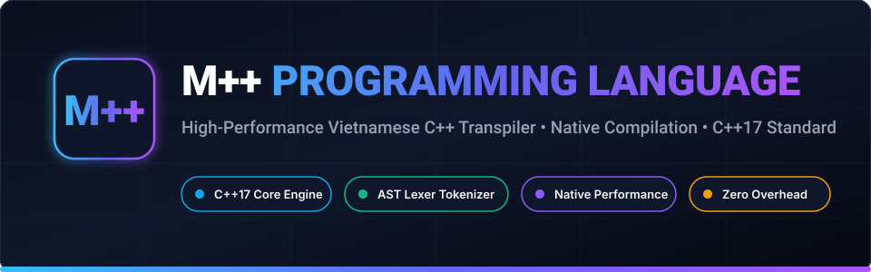
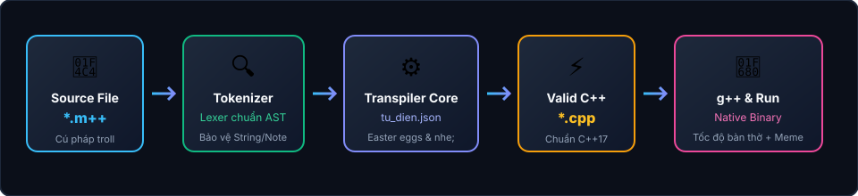

<p align="center">
  
</p>

<p align="center">
  <a href="#-giới-thiệu"></a>
  <a href="#-yêu-cầu-hệ-thống"></a>
  <a href="#-yêu-cầu-hệ-thống"></a>
  <a href="#-kiểm-thử-tự-động"></a>
  <a href="LICENSE"></a>
  <a href="#-tính-năng-nổi-bật"></a>
</p>

<h3 align="center">
  ⚡ Ngôn ngữ lập trình M++ • Hiệu năng C++17 nguyên bản • Trình biên dịch Transpiler tối ưu ⚡
</h3>

<p align="center">
  <b>M++ (M-Plus-Plus)</b> là một ngôn ngữ lập trình độc đáo, kết hợp giữa cú pháp tiếng Việt phong cách tự do và tốc độ thực thi tối đa của C++17. M++ được trang bị một <b>Transpiler chuẩn Lexer Tokenizer</b>, tự động chuyển đổi mã nguồn thành C++ chuẩn chỉ và biên dịch trực tiếp sang file thực thi nhị phân thông qua <code>g++</code>.
</p>

---

## 📑 Mục Lục
- [Kiến Trúc Hoạt Động](#-kiến-trúc-hoạt-động)
- [Tính Năng Nổi Bật](#-tính-năng-nổi-bật)
- [So Sánh C++ và M++](#-so-sánh-c-và-m)
- [Từ Điển Ánh Xạ M++](#-từ-điển-ánh-xạ-m)
- [Cài Đặt & Yêu Cầu](#-cài-đặt--yêu-cầu)
- [Cách Sử Dụng CLI](#-cách-sử-dụng-cli)
- [Kho Ví Dụ Mẫu](#-kho-ví-dụ-mẫu)
- [Kiểm Thử Tự Động](#-kiểm-thử-tự-động)
- [Đóng Góp](#-đóng-góp)
- [Giấy Phép](#-giấy-phép)

---

## 🏗 Kiến Trúc Hoạt Động

<p align="center">
  
</p>

1. **Phân tích từ vựng (Lexer Tokenizer)**: Quét luồng mã nguồn `.m++`, phân tách rõ ràng String literals, Char literals, Comment (`//`, `/* */`, `ke_chuyen:`), Number, Operator và Identifier.
2. **Bảo vệ tuyệt đối nội dung chuỗi**: Tokenizer cam kết **không bao giờ thay thế từ khóa** nằm trong chuỗi `""` hoặc comment.
3. **Bộ chuyển đổi ngữ nghĩa (Transpiler Core)**: Ánh xạ từ khóa theo `tu_dien.json`, chuẩn hóa đuôi câu lệnh `nhe;`/`ha;`, kích hoạt cơ chế chẩn đoán và kiểm tra cấu trúc ngoặc.
4. **Biên dịch & Tối ưu (g++ Compiler)**: Sử dụng `g++ -std=c++17 -O2` để sinh file nhị phân native thực thi trực tiếp với tốc độ tối đa.
5. **Chẩn đoán lỗi thông minh**: Tự động chuyển đổi các lỗi cú pháp và lỗi compiler thành thông báo tiếng Việt trực quan, chỉ rõ vị trí dòng code.

---

## 🚀 Tính Năng Nổi Bật

| Tính Năng | Mô Tả Chi Tiết |
|---|---|
| **🛡️ Tokenizer Chuẩn AST** | Không dùng regex replace chuỗi thô. Thoải mái viết `chuoi_hihi s = "nguyen_con troi_noi cha hihi nhe;";` mà không lo bị thay đổi nội dung bên trong chuỗi. |
| **💬 Comment `ke_chuyen:`** | Hỗ trợ thêm cú pháp comment dòng mới: `ke_chuyen: ...` bên cạnh comment truyền thống `//` và `/* */`. |
| **🤙 Đuôi Câu Linh Hoạt** | Dấu chấm phẩy `;` chuẩn C++ vẫn hoạt động, đồng thời hỗ trợ thêm đuôi câu `nhe;` và `ha;`. |
| **🐔 Kiểm Tra Luồng Xuất** | Hệ thống sẽ đưa ra thông báo nhắc nhở nếu chương trình hoàn toàn không có lệnh xuất dữ liệu `hihi` (`cout`). |
| **🥊 Chẩn Đoán Kiểu Biến** | Khai báo biến `cha` với kiểu dữ liệu khác `char` sẽ nhận thông báo chẩn đoán từ hệ thống. |
| **🤣 Chế Độ Thư Giãn (`--cuoi`)** | Sau khi chương trình kết thúc, hỗ trợ in một câu đùa lập trình viên giúp thư giãn khi làm việc. |
| **⚠️ Chẩn Đoán Thân Thiện** | Lỗi thiếu chấm phẩy, quên đóng ngoặc hay biến chưa khai báo được diễn giải rõ ràng, dễ hiểu. |

---

## 🔄 So Sánh C++ và M++

```cpp
// ==================== C++ ====================
#include <iostream>
using namespace std;

int main() {
    cout << "Xin chao the gioi!" << endl;
    return 0;
}
```

```m++
// ==================== M++ ====================
keu_ban <iostream>
xai_chung;

nguyen_con tran_dau() {
    hihi << "Xin chao the gioi!" << xuongdong nhe;
    tra_ve_haha 0 ha;
}
```

---

## 📖 Từ Điển Ánh Xạ M++

Toàn bộ từ khóa được định nghĩa trong file cấu hình độc lập [`tu_dien.json`](tu_dien.json):

### 1. Kiểu dữ liệu & Từ khóa cơ bản
| C++ | M++ | Ý nghĩa / Cách dùng |
|---|---|---|
| `int` | `nguyen_con` / `nguyen_xi` | Số nguyên con (Integer) |
| `float` | `troi_noi` / `le_te` | Số trôi nổi (Floating point) |
| `double` | `gap_doi` | Số thực gấp đôi (Double precision) |
| `char` | `cha` | Ký tự (Character) |
| `string` | `chuoi_hihi` | Chuỗi ký tự (String) |
| `bool` | `dungsai` | Kiểu logic đúng/sai (Boolean) |
| `void` | `trongtron` | Hàm không trả về giá trị (Void) |
| `const` | `khongdoi` | Hằng số (Const) |
| `true` | `chuan` | Giá trị đúng (True) |
| `false` | `sai_roi` | Giá trị sai (False) |
| `nullptr` | `hu_vo` | Con trỏ rỗng (Nullptr) |

### 2. Cấu trúc điều khiển & Vòng lặp
| C++ | M++ | Ý nghĩa / Cách dùng |
|---|---|---|
| `if` | `neuma` | Rẽ nhánh điều kiện |
| `else` | `khongthi` | Nhánh phủ định |
| `else if` | `khongthi_neuma` | Nhánh điều kiện bổ sung |
| `for` | `lapdi` | Vòng lặp đếm |
| `while` | `lapmai` | Vòng lặp điều kiện |
| `do` | `lamdi` | Thực hiện trước khi kiểm tra |
| `switch` | `chonbua` | Cấu trúc lựa chọn |
| `case` | `truonghop` | Nhánh trường hợp |
| `break` | `thoi` | Ngắt vòng lặp/khối lệnh |
| `continue` | `bolua` | Bỏ qua bước lặp hiện tại |
| `return` | `tra_ve_haha` | Trả về giá trị của hàm |

### 3. Hàm, Lớp & Đối tượng
| C++ | M++ | Ý nghĩa / Cách dùng |
|---|---|---|
| `main` | `tran_dau` | Hàm thực thi chính (Main function) |
| `class` | `bang_nhom` | Lớp đối tượng (Class) |
| `struct` | `cuc_cuc` | Cấu trúc dữ liệu (Struct) |
| `public` | `congkhai` | Phạm vi công khai |
| `private` | `bimat` | Phạm vi riêng tư |
| `protected` | `giu_kin` | Phạm vi bảo vệ nội bộ |
| `new` | `de_moi` | Cấp phát bộ nhớ động |
| `delete` | `xoa_sach` | Giải phóng bộ nhớ động |

### 4. Vào / Ra & Thư viện chuẩn (Mở rộng)
| C++ | M++ | Ý nghĩa / Cách dùng |
|---|---|---|
| `cout` | `hihi` | Luồng xuất dữ liệu (Output stream) |
| `cin` | `haha` | Luồng nhập dữ liệu (Input stream) |
| `endl` | `xuongdong` | Xuống dòng và đẩy bộ đệm |
| `#include` | `keu_ban` | Nhúng thư viện |
| `using namespace std` | `xai_chung` | Không gian tên chuẩn |
| `vector` | `hang_dai` | Mảng động co giãn (Vector) |
| `size()` | `bao_nhieu` | Số lượng phần tử |
| `push_back()` | `nhet_vao` | Thêm phần tử vào cuối |
| `pop_back()` | `moc_ra` | Loại bỏ phần tử cuối |
| `sqrt()` | `can_bac_hai_ne` | Hàm căn bậc hai |
| `swap()` | `doi_cho` | Hoán đổi 2 phần tử |
| `sort()` | `xep_hang` | Sắp xếp mảng / vector |
| `min()` / `max()` | `nho_nhat` / `bu_nhat` | Tìm giá trị nhỏ nhất / lớn nhất |
| `abs()` / `pow()` | `tuyet_doi_nha` / `mu_len` | Trị tuyệt đối / Lũy thừa |
| `begin()` / `end()` | `bat_dau` / `ket_thuc` | Con trỏ đầu / cuối mảng |

---

## 💻 Cài Đặt & Yêu Cầu

1. **Python 3.8+** (Khuyên dùng Python 3.10, 3.11 hoặc 3.12).
2. **Trình biên dịch C++** hỗ trợ C++17 trở lên (`g++` từ MinGW-w64, MSYS2, GCC trên Linux, hoặc Clang trên macOS).

Kiểm tra môi trường trong terminal:
```bash
python --version
g++ --version
```

Clone mã nguồn về máy:
```bash
git clone https://github.com/manhdan99/mpp.git
cd mpp
```

---

## ⚡ Cách Sử Dụng CLI

### 1. Dịch và Chạy Trực Tiếp
```bash
# Windows
.\mpp.bat chay vi_du/01_hello.m++

# Linux / macOS
./mpp chay vi_du/01_hello.m++

# Hoặc dùng python trực tiếp
python mpp.py chay vi_du/01_hello.m++
```

### 2. Kích Hoạt Chế Độ Thư Giãn (`--cuoi`)
```bash
.\mpp.bat chay vi_du/02_tinh_tong.m++ --cuoi
```

### 3. Chỉ Dịch Sang File C++ Hợp Lệ
```bash
# Tự động xuất vi_du/01_hello.cpp
.\mpp.bat dich vi_du/01_hello.m++

# Hoặc chỉ định tên file mong muốn
.\mpp.bat dich vi_du/01_hello.m++ -o hello.cpp
```

### 4. Xem Trợ Giúp
```bash
.\mpp.bat tro_giup
```

---

## 📂 Kho Ví Dụ Mẫu

Thư mục [`vi_du/`](vi_du/) chứa 7 chương trình mẫu từ cơ bản đến nâng cao:

| File | Mô Tả | Điểm Nhấn Cú Pháp |
|---|---|---|
| [`01_hello.m++`](vi_du/01_hello.m++) | Hello World | `keu_ban`, `xai_chung`, `hihi`, `nhe;`, `ha;` |
| [`02_tinh_tong.m++`](vi_du/02_tinh_tong.m++) | Tính tổng 1..N | `lapdi`, `neuma`, `khongthi`, `tra_ve_haha` |
| [`03_giai_thua.m++`](vi_du/03_giai_thua.m++) | Tính giai thừa | Đệ quy, vòng lặp `lapmai`, `dai_thoong` |
| [`04_so_nguyen_to.m++`](vi_du/04_so_nguyen_to.m++) | Sàng lọc số nguyên tố | `can_bac_hai_ne`, `dungsai`, `chuan`, `bolua`, `thoi` |
| [`05_sap_xep_mang.m++`](vi_du/05_sap_xep_mang.m++) | Sắp xếp mảng / vector | `hang_dai`, `nhet_vao`, `doi_cho`, `xep_hang`, `bat_dau` |
| [`06_oop_bang_nhom.m++`](vi_du/06_oop_bang_nhom.m++) | Hướng đối tượng OOP | `bang_nhom`, `cuc_cuc`, `congkhai`, `bimat`, `de_moi`, `xoa_sach` |
| [`07_test_troll.m++`](vi_du/07_test_troll.m++) | Kiểm tra bảo vệ chuỗi | Biến `cha` kích hoạt cảnh báo, chuỗi giữ nguyên từ khóa |

---

## 🧪 Kiểm Thử Tự Động

M++ đi kèm bộ test tự động kiểm thử toàn diện 13 kịch bản:

```bash
python -m unittest tests/test_mpp.py -v
```

```
test_easter_egg_cam_nhu_hen ... ok
test_easter_egg_cha_not_char ... ok
test_jokes_generation ... ok
test_ke_chuyen_comment ... ok
test_cha_as_char_no_warning ... ok
test_run_all_samples ... ok
test_syntax_endings_nhe_and_ha ... ok
test_syntax_error_missing_main ... ok
test_syntax_error_unclosed_brace ... ok
test_tokenizer_preserves_comments ... ok
test_tokenizer_preserves_escaped_strings ... ok
test_tokenizer_preserves_strings ... ok
test_tu_dien_json ... ok

----------------------------------------------------------------------
Ran 13 tests in 4.6s

OK (100% Passed)
```

---

## 🤝 Đóng Góp

Mọi đóng góp từ cộng đồng đều được chào đón!
1. Fork dự án
2. Tạo nhánh tính năng (`git checkout -b feature/tu-khoa-moi`)
3. Thêm từ khóa vào [`tu_dien.json`](tu_dien.json)
4. Viết test trong [`tests/test_mpp.py`](tests/test_mpp.py)
5. Mở Pull Request!

---

## 📜 Giấy Phép

Phát hành dưới giấy phép [MIT License](LICENSE). Tự do học tập, sửa đổi và chia sẻ!
